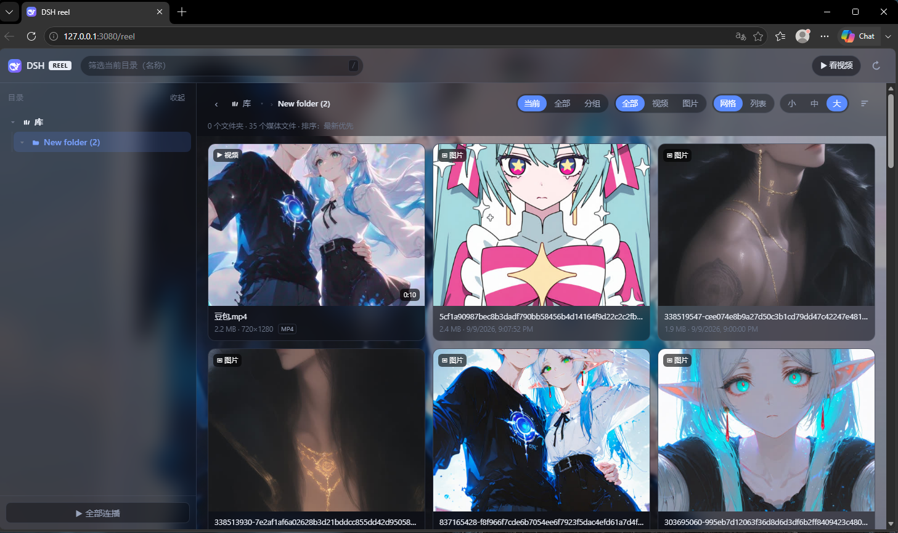
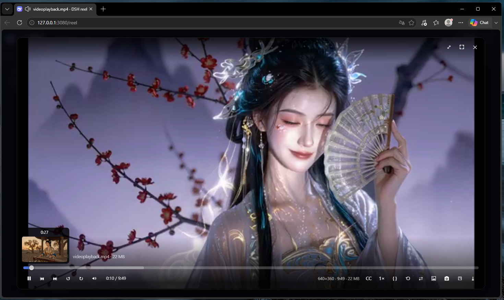
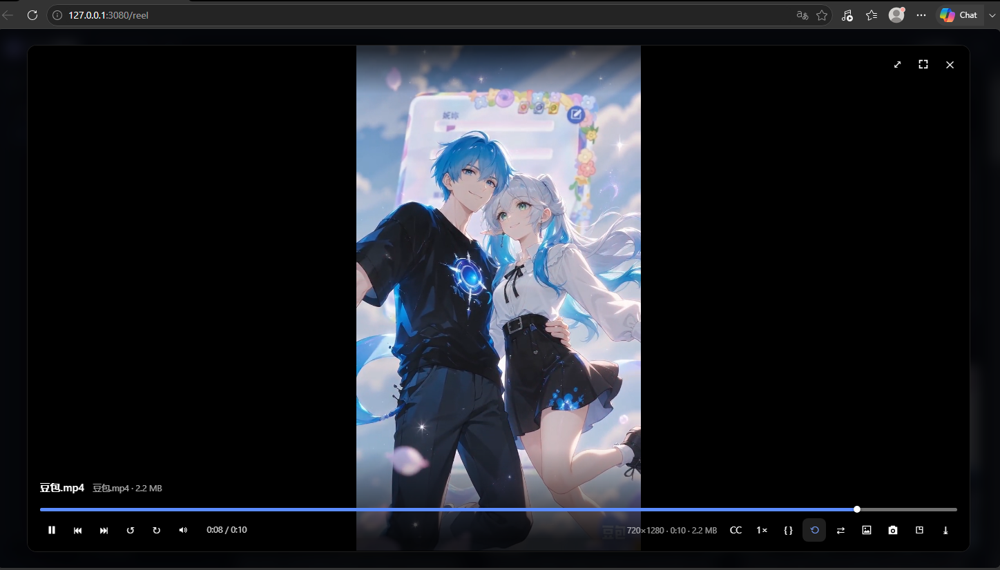
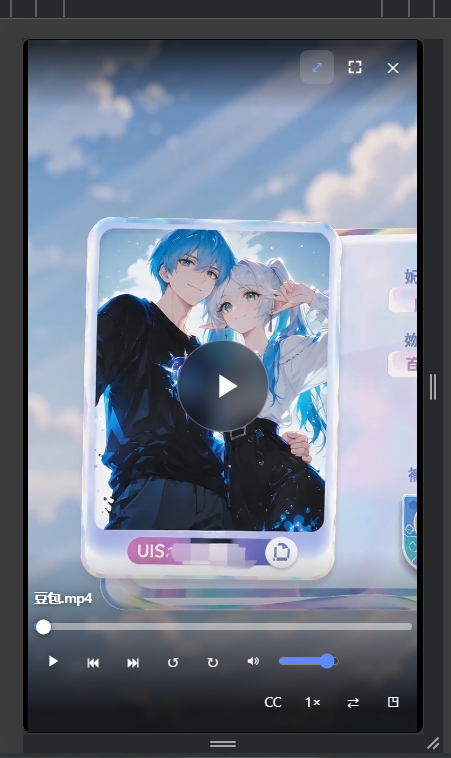
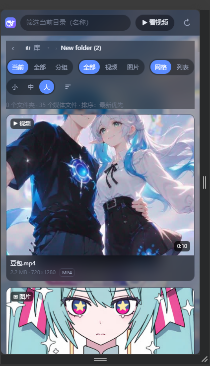
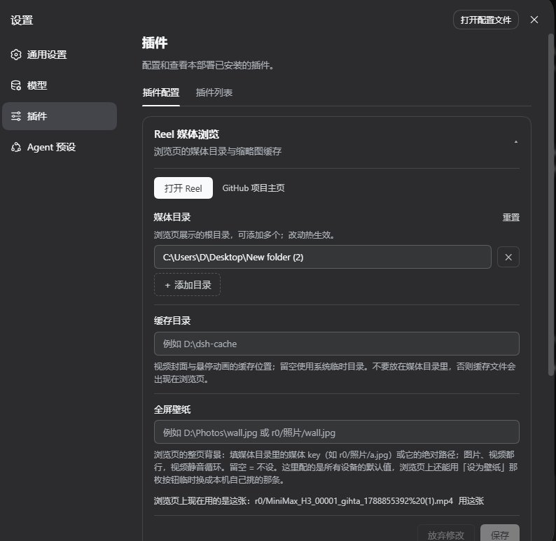

<p align="center">
  
</p>

<h1 align="center">dsh-reel</h1>

<p align="center">
  <strong>专为 dsh Web 打造的现代化流媒体库与沉浸式画廊插件</strong>
</p>

<p align="center">
  本地多媒体目录聚合 · HTTP Range 流式秒播 · 服务端边转边播 · 动态全屏壁纸 · 触控手势连播
</p>

<p align="center">
  
  <a href="https://github.com/deepseek-ai/deepseek-harness/releases/tag/dsh-v0.2.0-rc.1">= v0.2.0-rc.1" /></a>
  
  
  
</p>

<p align="center">
  
  
  
  
</p>

<p align="center">
  <strong>简体中文</strong> · <a href="README.en.md">English</a>
</p>

---

<p align="center">
  
</p>

## 简介

**dsh-reel** 为 [dsh Web](https://github.com/deepseek-ai)（要求 dsh 最低版本为 [v0.2.0-rc.1](https://github.com/deepseek-ai/deepseek-harness/releases/tag/dsh-v0.2.0-rc.1)）提供了一站式的媒体库浏览与沉浸式影音播放体验。无需启动独立的流媒体服务或新端口，只需一条命令挂载多个本地磁盘目录，即可立即在浏览器中畅享高性能的图片画廊与流媒体播放器。

项目地址与快速访问：
```
http://127.0.0.1:3080/reel
```

---

## 核心特性

- **零额外进程，轻量内嵌**：与 dsh Web 同端口、同 origin；宿主侧仅新增一行 Cordis 组合配置与 `/reel` 前缀下的只读路由，不启动新守护进程，无需额外打包构建步骤。
- **严格安全沙箱**：对本地媒体目录严格只读；所有目录枚举与文件读取均限制在白名单根路径内，杜绝路径穿越风险。
- **多目录聚合 & 多维视图**：
  - 顶层「库」智能聚合所有已挂载的磁盘目录，层级按需惰性加载。
  - **当前**、**全部**（递归平铺）、**分组**（按目录折叠）三种浏览模式随心切换。
  - 网格布局（小 / 中 / 大三档尺寸自适应）与紧凑列表视图。
- **HTTP Range 流式秒开**：视频原生采用 HTTP Range 响应流式分发，任意拖拽进度条即时起播，不阻塞带宽。
- **服务端边转边播**：对于 AVI、WMV、FLV、RMVB 等浏览器无法原生解码的老旧容器，服务端由 ffmpeg 实时转封装为 fragmented MP4 边转边发，内存管道直出，零磁盘临时占用；拖动进度条自动从目标时间重新建立流。
- **悬停预览与精准帧截取**：进度条悬停即时展示缩略图预览与时间戳；内置 FFmpeg / FFprobe 支持，自动提取视频时长、分辨率与高质量封面海报。
- **沉浸式全屏动态壁纸**：
  - 任意图片或视频一键设为全站全局动态壁纸（视频静音循环，失焦自动暂停节能）。
  - 全屏半透明毛玻璃质感 UI 交互，视觉体验拉满。
- **触控手势连播 & 移动端全适配**：
  - 手机端与窄屏自适应布局，支持上下滑动切换上一条 / 下一条（类似 Reels / 抖音短视频跟手滑动交互）。
  - 支持顺序连播、随机洗牌播放、播放位置记忆、长按 2× 快进、外挂同名字幕自动加载与当前帧截图导出。
- **dsh 原生可视化设置**：完全集成于 dsh 设置面板，增删媒体目录、设定缓存与壁纸热更新即刻生效。

---

## 界面预览

### 沉浸式动态壁纸模式
将喜欢的视频或图片一键设为全站背景，界面组件自动转为通透的毛玻璃半透明层：
<p align="center">
  
</p>

### 专业级视频播放器
页内全屏播放器，支持进度条悬停缩略图、元数据探查、倍速切换、截图与循环连播：
<p align="center">
  
</p>

### 竖屏视频与移动端短视频连播
无论是在桌面端还是移动设备，竖屏视频均自适应居中或铺满，支持滑动手势畅快刷剧：
<p align="center">
  
  &nbsp;&nbsp;
  
</p>

### 移动端响应式画廊
针对手机触控优化，单列自适应卡片与手势放大浏览：
<p align="center">
  
</p>

### dsh 设置中心原生集成
在 dsh 设置中轻松配置媒体目录、指定缓存位置并管理全局壁纸：
<p align="center">
  
</p>

---

## 安装指南

### 前置要求

- **dsh**：要求最低版本为 [v0.2.0-rc.1](https://github.com/deepseek-ai/deepseek-harness/releases/tag/dsh-v0.2.0-rc.1) 及以上（0.2.0 起 settings 客户端契约变更，旧版不再兼容）
- **Node.js**：`>= 20`

### 标准安装

在 dsh 运行环境下，执行以下命令安装插件：

```powershell
dsh plugin --profile web add dsh-reel
```

重启 `dsh web`，在浏览器打开：
```
http://127.0.0.1:3080/reel
```

### 安装未发布版本 / 源码本地开发

```powershell
# 从 GitHub 仓库直接安装最新开发版
dsh plugin --profile web add "github:lsjspl/dsh-reel"

# 本地源码调试软链模式
dsh plugin --profile web add "link:C:\path\to\dsh-reel"
```

链接安装直接使用这个目录中的源码。修改前端 HTML/CSS/JS 后刷新浏览器即可；修改后端模块后，需要重新加载插件或重启 dsh，浏览器刷新不会替换进程内已经加载的模块。

### 卸载插件

```powershell
dsh plugin --profile web remove dsh-reel
```

---

## 配置说明

配置存放在 profile 的 `cordis.patch.yml` 里 `reel` 的 `config` 段——设置面板保存的也是这一层。其中媒体目录、缓存目录、全屏壁纸三项热生效，无需重启服务。

### 方式一：可视化界面配置（推荐）

打开 **侧边栏「插件」面板 → 「已安装」分组 → dsh-reel**，配置区就在包描述下方：
- **媒体目录**：点击「添加目录」添加多个本地文件夹（如 `D:\Photos`、`E:\Videos`）。
- **缓存目录**：指定视频封面帧与悬停预览的缓存磁盘位置。
- **全屏壁纸**：配置全站默认壁纸（可填文件绝对路径或库相对 key）。

卡片顶部还有**「在浏览器里打开」**按钮和一行**浏览页地址**（带复制按钮）。地址是绝对 http URL，来自 dsh 实际服务的端口，因此桌面端与 Web 端显示的都不一样、也都点得开。

这三个字段是**热生效**的：保存后立即作用于正在运行的服务，不需要重启 `dsh web`。

> [!NOTE]
> 配置入口是**「插件」面板里的 bundle 详情页**，不是「设置 → 内置插件」。后者是只读的插件清单，不提供任何配置项。

### 方式二：配置文件 / `cordis.patch.yml`

在 profile 的 `cordis.patch.yml` 中声明（设置面板保存的也是这一层）：

```yaml
- id: reel
  config:
    roots:
      - D:\Photos
      - E:\电影
    # cacheDir: 'D:\dsh-cache'              # 缩略图与悬停动画缓存目录，留空使用系统临时目录
    # wallpaper: 'D:\Photos\wallpaper.jpg'  # 全局默认壁纸路径
    # ffmpegPath: 'D:\ffmpeg\bin\ffmpeg.exe' # 手动指定 ffmpeg 路径；留空自动探查
    # requireTrustedRequest: true           # 局域网访问信任拦截，设为 false 允许非回环直连
    # maxScanEntries: 20000                 # 每页扫描目录条目的工作预算 (50 ~ 200000)
```

> [!NOTE]
> - 当 `roots` 为空时，将依次回退至环境变量 `REEL_ROOTS`（多路径用 `;` 分隔）以及 `$DSH_HOME/media`。
> - `cacheDir` 请务必放置在媒体目录之外，避免生成的缩略图文件被误扫入媒体库中。
> - `roots` / `cacheDir` / `wallpaper` 改完即热生效；`ffmpegPath` / `requireTrustedRequest` / `maxScanEntries` 属于进程级决策，改动需要重启。

### 媒体地址、扫描与资源限制

- 媒体 key 的根标识由规范化后的配置路径确定，目录离线、重排、删除其他目录或服务重启都不会重新编号。请使用浏览页或 `/reel/api/session` 返回的根标识，避免自行填写序号。
- 旧版 `r0/r1` 位置型 key 不再解析。升级后请重新打开 `/reel` 并保存新链接；旧 key 配置的壁纸需重新选择或改用绝对路径，旧 key 下的续播进度不会自动套用到新媒体。
- 平铺浏览和搜索共用后台媒体索引，支持当前范围或全部硬盘的文件名、路径搜索。结果每页 120 条；索引最多 500,000 个媒体、64 层目录，刷新期间保留上一次结果。首次扫描、冷缩略图和转码速度取决于硬盘与编码，索引并不保证任意文件瞬时打开。
- “分组”使用可续扫的目录游标，每页最多返回 3000 条媒体，达到 `maxScanEntries` 工作预算后同样返回 `nextCursor`；分组扫描目录深度上限为 32 层。
- API 调用方应使用相同的 `k`、`kinds`、`depth` 并原样携带 `nextCursor` 继续请求，直到它为 `null`；游标空闲 60 秒后过期，配置改变后也需重新扫描。每个插件实例最多保留 16 个扫描会话，取消请求、过期及卸载时释放目录句柄。
- 实时转码最多同时运行 2 个进程，每个进程的解码和编码线程数为 2。超限返回 `503` 和 `Retry-After: 2`；启动 25 秒无输出、输出后连续 30 秒无进展时终止进程。慢客户端的背压暂停不计入停滞超时，关闭连接及卸载插件也会终止相关进程。
- `requireTrustedRequest` 在插件配置层默认开启，仅显式设为 `false` 时关闭。SVG 原文件响应附带 CSP 沙箱及脚本限制，避免打开本地 SVG 时获得 dsh 同源权限。

### 关于端口

**插件没有自己的端口，也不需要配。** 浏览页挂在 dsh 自己的 `webServer` 上，和 dsh 的界面同端口、同源：

| 运行环境 | 地址 |
|---|---|
| **Web**（`dsh web`） | `http://127.0.0.1:<dsh 的 --port>/reel`，默认 `3080` |
| **桌面端**（Electron） | `http://127.0.0.1:19387/reel`（端口由 dsh 桌面端固定传入） |

桌面端不是例外：它通过 `dsh-desktop-host` 启动**同一套 web bundle**（`@deepseek-ai/dsh-base` + `@deepseek-ai/dsh-web-app`），并向它传入 `--port 19387`，因此 `webServer` 一样存在，浏览页一样挂在上面。要换桌面端端口，改的是**整个桌面应用的端口**，不是本插件的配置——在 `profiles/desktop/cordis.patch.yml` 里覆盖 `webserver` 行即可。

实际地址以设置卡片上显示的那一行为准：`/reel/api/session` 会按**请求实际到达的 Host** 报告绝对地址，所以不管从哪个地址访问 dsh，卡片给出的都是那个地址。

> [!NOTE]
> **为什么卡片要用绝对地址打开**：桌面端的页面 origin 是 `dsh-app://app`，而不是 `http://127.0.0.1:19387`。相对路径 `/reel` 在这里会解析成 `dsh-app://app/reel`，桌面外壳只把 `http:`/`https:` 导航交给系统浏览器，其余协议一律拒绝——点了会毫无反应。绝对 http 地址因此和卡片里那条 GitHub 链接走同一条路。

---

## FFmpeg / FFprobe 智能探查

插件默认引入了 `@ffmpeg-installer/ffmpeg` 和 `@ffprobe-installer/ffprobe` 作为开箱即用的内置兜底，**无需手动安装任何外部依赖**即可享受封面抓取与视频转封装。

如果需要支持更多现代硬件解码与最新编码特性，建议在系统中安装一份新版 ffmpeg：

```powershell
# Windows (WinGet / Scoop / Chocolatey)
winget install ffmpeg

# macOS (Homebrew)
brew install ffmpeg

# Linux (Debian / Ubuntu)
sudo apt update && sudo apt install ffmpeg
```

### 运行时探查优先级：
1. 配置项中显式指定的 `ffmpegPath`；
2. `$DSH_HOME/reel/bin/` 目录；
3. 系统环境 PATH 变量及系统标准目录（WinGet Links、Scoop shims、`/usr/local/bin` 等）；
4. 插件自带的依赖包版本（保底）。

---

## 功能深度详解

### 1. 媒体库浏览
- **目录树**：左侧展示各目录根节点与子树，层级惰性加载；点击最顶层「库」可直接聚合全库内容。
- **三种模式（快捷键 G）**：
  - **当前**：仅浏览当前文件夹内容；
  - **全部**：递归平铺展示子树下的所有媒体文件；
  - **分组**：递归扫描并按文件夹折叠聚合，结构层次分明。
- **面包屑导航**：顶部路径栏支持点击跳转各级目录，`▾` 展开兄弟目录，`‹` 或 `Backspace` 快速返回上级。
- **搜索与过滤**：按 `/` 定位搜索框，可选择当前范围或全部硬盘；搜索完整索引中的文件名和路径，多词按 AND 匹配，支持「全部 / 视频 / 图片」筛选。
- **动态封面**：桌面悬停、手机滚动停下后播放无声 MP4 微缩预览，同时只播放一张。显示设置中可关闭，系统减少动态效果和省流量设置默认禁用自动预览。

### 2. 影音播放体验
- **刷视频**：点击顶栏或手机底部“刷视频”，从零观看短片，默认循环当前条目；上下滑动、滚轮和箭头切片。普通播放保留续播与连播设置，滑动和滚轮不会误切文件。
- **智能连播**：支持顺序与随机播放，在更多菜单中切换。刷视频只预读下一条可直接播放视频的元数据，不提前启动另一个转码进程。
- **精准取帧与微缩预览**：鼠标划过进度条时实时浮现对应时间的画面缩略图与精确时间。
- **播放进度记忆**：自动记录播放时间点，再次打开即刻续播。
- **拖动与长按**：拖动进度条时主画面跟随位置，不主动暂停；转码视频通过实时取帧显示目标画面。轻点快进/后退跳转 10 秒，长按持续快进/后退，松开恢复原播放状态。
- **更多工具**：支持 0.25× ~ 3× 倍速（长按画面 2× 极速快进）、自动关联并挂载同名 `.vtt` / `.srt` 字幕、当前帧高清截图导出、原片极速下载。

### 3. 图片查看器
- 点击网格封面平滑弹出图片查看器；
- 支持鼠标滚轮无级缩放、双击 2× 放大/还原、按住拖拽平移画面；
- 键盘 `←` / `→` 键即时翻页，移动端支持双指捏合缩放与横滑切图。

### 4. 沉浸式动态壁纸
- 在播放器或图片查看器中点击「设为壁纸」按钮，即可将当前音视频或美图固定为全页面背景；
- 视频壁纸自动静音无缝循环播放；当浏览器标签页处于后台时智能暂停，丝毫不占系统性能。

---

## 快捷键速查表

### 列表页 / 画廊

| 按键 | 功能说明 |
|:---:|:---|
| <kbd>G</kbd> | 轮换内容模式（当前层级 → 递归全部 → 折叠分组） |
| <kbd>V</kbd> | 切换视图（网格 Grid ⇄ 列表 List） |
| <kbd>S</kbd> | 切换排序规则（最新优先、名称、大小等） |
| <kbd>R</kbd> | 重新加载刷新媒体库 |
| <kbd>/</kbd> | 聚焦并激活顶部搜索框 |
| <kbd>Backspace</kbd> / <kbd>Ctrl</kbd>+<kbd>↑</kbd> | 返回上一层目录 |
| <kbd>Esc</kbd> | 关闭图片查看器 / 取消搜索框聚焦 |

### 视频播放器

| 按键 | 功能说明 |
|:---:|:---|
| <kbd>Space</kbd> / <kbd>K</kbd> | 播放 / 暂停 |
| <kbd>←</kbd> / <kbd>→</kbd> | 单按后退 / 前进 5 秒，长按持续后退 / 快进；点击播放器按钮后仍可使用 |
| 聚焦时间轴时的 <kbd>←</kbd> / <kbd>→</kbd> | 精调 1 秒；按住 Shift 调整 10 秒 |
| <kbd>J</kbd> / <kbd>L</kbd> | 后退 / 前进 10 秒 |
| <kbd>↑</kbd> / <kbd>↓</kbd> | 音量微调 (±5%) |
| <kbd>M</kbd> | 静音 / 取消静音 |
| <kbd>F</kbd> | 网页全屏 / 退出全屏 |
| <kbd>Q</kbd> | 开启 / 关闭画中画 (PiP) |
| <kbd>C</kbd> | 打开 / 关闭字幕选择菜单 |
| <kbd>I</kbd> | 显示详细统计信息 (Stats for nerds) |
| <kbd>U</kbd> | 切换单曲循环 / 列表连播 |
| <kbd>P</kbd> | 截取当前视频帧并保存为 PNG 图片 |
| <kbd>D</kbd> | 下载当前播放的原媒体文件 |
| <kbd>[</kbd> / <kbd>]</kbd> | 降低 / 提高播放倍速 (0.25× ~ 3×) |
| <kbd>0</kbd> | 还原为 1.0× 正常播放倍速 |
| <kbd>Home</kbd> / <kbd>End</kbd> | 跳转到视频片头 / 片尾 |
| <kbd>Esc</kbd> | 退出全屏 / 关闭二级菜单 / 关闭播放器 |
| **鼠标左键长按** | 2.0× 临时极速快进 (松开立即恢复原速) |
| **鼠标滚轮 / 触摸屏上下滑** | 切换上一条 / 下一条视频 (短视频式跟手切换) |

---

## 友情链接

- [linux.do](https://linux.do/) - 新的理想型社区。

---

## 开源许可

本项目基于 [MIT License](LICENSE) 协议开源。

欢迎提交 [Issue](https://github.com/lsjspl/dsh-reel/issues) 反馈建议或发起 [Pull Request](https://github.com/lsjspl/dsh-reel/pulls)！
